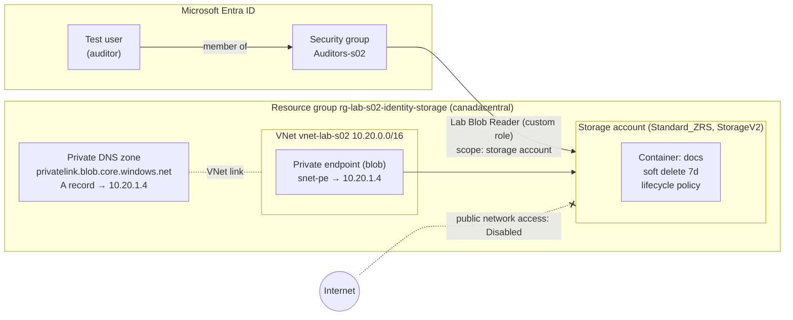

# S02 – Identity, Governance & Storage (Azure CLI)

Hands-on lab from my 60-week Azure learning plan (architect, DevOps, security track).
Everything is built with **Azure CLI** from WSL (Ubuntu) and scripted in [`deploy.sh`](./deploy.sh).

> No real environment values are committed: IDs, account names and UPNs live in a local `vars.sh` (git-ignored).
> Copy [`vars.example.sh`](./vars.example.sh) to `vars.sh` and fill in your own values.

---

## Scenario

A company stores audit reports in Azure. Requirements:

| # | Requirement | How it is met |
|---|---|---|
| 1 | An **auditors team** can **read** the reports | Entra ID security group + custom RBAC role, scoped to the storage account |
| 2 | Auditors **cannot modify** anything or **retrieve the access keys** | Role has `blobs/read` only, no write, no `listKeys/action` |
| 3 | Access is **named and traceable** | Microsoft Entra ID auth (`--auth-mode login`), no shared keys |
| 4 | Data survives **a datacenter outage** | `Standard_ZRS` (3 copies across availability zones) |
| 5 | Accidental **deletes or overwrites** can be undone | Blob + container soft delete (7 days) |
| 6 | Reports are kept **7 years**, at the lowest reasonable cost | Lifecycle management policy |
| 7 | An external auditor can get **temporary, read-only** access to one file | User delegation SAS |
| 8 | Data is reachable **from the private network only** | Private endpoint + Private DNS zone, public network access disabled |
| 9 | Everything stays **in Canada**, every resource is **tagged** | Azure Policy (built-in definitions assigned to the resource group) |
| 10 | The storage account cannot be **deleted by mistake** | Resource lock `CanNotDelete` |

---

## Architecture



---

## Components and design decisions

### 1. Custom RBAC role – `Lab Blob Reader (s02)`
Defined in [`custom-role.template.json`](./custom-role.template.json) (`$SCOPE` is substituted with `envsubst` at deploy time).

| Field | Content | Why |
|---|---|---|
| `Actions` | `storageAccounts/read`, `containers/read`, `resourceGroups/read` | See the account and containers (control plane) |
| `DataActions` | `containers/blobs/read` | Read report content (data plane) |
| Not included | `listKeys/action`, any `write`/`delete` | No key-based bypass, no modification |
| `AssignableScopes` | The lab resource group | Cannot be assigned elsewhere |

**Built-in alternative:** `Reader` + `Storage Blob Data Reader` on the storage account. In production I would prefer built-in roles (less maintenance); the custom role here is for learning the role definition structure.

### 2. Role assignment – group, not user; storage account, not resource group
- Assigned to the **security group**: onboarding/offboarding an auditor = group membership change, **zero** role assignment changes.
- Scoped to the **storage account**: a future storage account added to the resource group would *not* inherit auditor access (least privilege includes *future* resources).

### 3. Storage account
- `Standard_ZRS`, `StorageV2`, Hot default tier, `--min-tls-version TLS1_2`, `--allow-blob-public-access false`.
- Container `docs` created with `az storage container-rm create` (**control plane**), because as Owner I had no data-plane role: the same container via `az storage container create --auth-mode login` would return 403. *The endpoint you go through decides which permission is checked.*

### 4. Soft delete
Blob and container soft delete, 7 days. Protects against deletes **and overwrites**, but **not** against deleting the storage account itself (that is what a resource lock is for).

### 5. Lifecycle management – [`lifecycle-policy.json`](./lifecycle-policy.json)

| Days since last modification | Action |
|---|---|
| 30 | Move to Cool |
| 90 | Move to Cold |
| 2557 (≈ 7 years, rounded up for leap years) | Delete |

- **Last modified** (not last access): reports are immutable once signed, so the schedule stays predictable; a read must not postpone legal deletion.
- **Trade-off:** the Archive tier is **not supported on ZRS** accounts. Options were Cold on ZRS (chosen for the lab), a second GRS account for archiving (production design), or downgrading redundancy. Minimum durations (Cool 30 d, Cold 90 d) are respected at every step.

### 6. User delegation SAS
- Signed with an Entra ID–derived **user delegation key**, not the account key (`--auth-mode login --as-user`); max validity 7 days; `skoid`/`sktid` fields tie it to its creator.
- Effective permissions = **intersection** of the SAS permissions and the creator's own data actions.
- Requires `generateUserDelegationKey/action` (included in the built-in Storage Blob Data roles, **not** in my custom role).

### 7. Private endpoint + Private DNS
- Private endpoint (`group-id blob`) in `snet-pe`, private IP `10.20.1.4`.
- Private DNS zone `privatelink.blob.core.windows.net`, **VNet link** (auto-registration off), **DNS zone group** to create/maintain the A record automatically.
- Public network access **disabled last** – creating a private endpoint does not close the public endpoint by itself.
- Hybrid note: on-premises clients also need a **conditional forwarder** (to an Azure DNS Private Resolver inbound endpoint), otherwise their DNS returns the public IP even over VPN.

**VNet** (`10.20.0.0/16`, subnet `snet-pe` `10.20.1.0/24`):


**Private endpoint** – private IP `10.20.1.4`, target sub-resource `blob`, connection approved (storage account name redacted):


**Private DNS zone** – 2 record sets (SOA + the A record created by the DNS zone group), 1 VNet link, auto-registration off:


### 8. Azure Policy – built-in definitions, assigned to the resource group
No custom policy definition: two **built-ins** are assigned at the resource group scope with parameters.

| Assignment | Built-in definition | Parameters | Effect |
|---|---|---|---|
| `S02 - Allowed locations (Canada only)` | Allowed locations (`e56962a6-4747-49cd-b67b-bf8b01975c4c`) | `listOfAllowedLocations` = `canadacentral`, `canadaeast` | `Deny` (the effect is itself a parameter) |
| `S02 - Require tag env on resources` | Require a tag on resources (`871b6d14-10aa-478d-b590-94f262ecfa99`) | `tagName` = `env` | `deny` (hard-coded in the definition) |

- **RBAC vs Policy:** RBAC decides *who* may perform an action; Policy decides whether the *resource* is compliant. Policy applies to everyone, **Owner included**.
- **Audit before Deny** in production: Deny does not delete existing non-compliant resources, but it blocks any **update** to them (the whole resource is re-evaluated, including its location). An effect exposed as a parameter lets the same assignment move from `Audit` to `Deny` by changing one value.
- Built-in GUIDs are identical in every tenant, which makes them safe to reference in scripts and IaC.
- Not covered here: `Modify` / `DeployIfNotExists` with remediation tasks (they require a managed identity on the assignment).

### 9. Resource lock – `CanNotDelete` on the storage account
- `CanNotDelete` rather than `ReadOnly`: teams still change settings (tags, lifecycle rules). `ReadOnly` would block every write, including `listKeys` (a POST action), which breaks key-based clients.
- Locks protect the **control plane** only: deleting the account is blocked, deleting **blobs** is not (that is what soft delete is for).
- Locks are inherited downwards; a lock on any child resource blocks deleting its resource group. Removing a lock requires `Microsoft.Authorization/locks/*` (Owner, User Access Administrator), not Contributor.

---

## Tests and results

| Test | Identity / method | Expected | Result |
|---|---|---|---|
| Upload as Owner, no data role | `--auth-mode login` | 403 | ✅ 403 (Owner has no DataActions) |
| Upload after `Storage Blob Data Contributor` | `--auth-mode login` | Success | ✅ |
| Auditor downloads report | Test user via group | Success | ✅ |
| Auditor uploads a file | Test user via group | 403 | ✅ AuthorizationPermissionMismatch |
| Auditor lists access keys | Test user via group | Denied | ✅ AuthorizationFailed on `listKeys/action` |
| Soft delete: delete, list `--include d`, undelete | Data plane | Restored | ✅ |
| Read with user delegation SAS (`sp=r`) | No identity, `curl` | 200 | ✅ |
| Write with the same SAS | No identity, `curl -X PUT` | 403 | ✅ AuthorizationPermissionMismatch |
| Tampered SAS | `curl` | 403 | ✅ AuthenticationFailed |
| DNS before private endpoint | `nslookup` | Public IPs, no `privatelink` | ✅ |
| DNS after private endpoint (from Internet) | `nslookup` | `privatelink` CNAME added, still public IP | ✅ |
| Anonymous request after public access disabled | `curl` | 403 before blob existence check (would be 404 otherwise) | ✅ 403 |
| My own identity after public access disabled | `--auth-mode login` | Blocked by network rules | ✅ |
| Control plane after public access disabled | `az storage account show` | Works | ✅ |
| Create NSG in East US (with tag), as Owner | Policy | Denied | ✅ RequestDisallowedByPolicy (Allowed locations) |
| Create NSG in Canada Central (with tag) | Policy | Created | ✅ |
| Create NSG in Canada Central without tag | Policy | Denied | ✅ RequestDisallowedByPolicy (Require tag) |
| Create NSG in East US without tag | Policy | Denied by both | ✅ Both assignments listed in one error |
| Delete the locked storage account, as Owner | Lock | Denied | ✅ ScopeLocked |
| Update tags on the locked storage account | Lock | Works | ✅ |

**Which layer blocked me?** The error code tells you where to look:

| Error code | Layer | First thing to check |
|---|---|---|
| `AuthorizationFailed` / `AuthorizationPermissionMismatch` | RBAC | Role (control vs data plane) and scope |
| `RequestDisallowedByPolicy` | Azure Policy | The assignment named in the message, and its parameters |
| `ScopeLocked` | Resource lock | The locked scope named in the message (resource or parent) |
| `AuthenticationFailed` | Authentication | Identity or SAS signature is invalid |

---

## Lessons learned

- **Authentication vs authorization:** `AuthenticationFailed` (who are you? invalid proof) vs `AuthorizationPermissionMismatch` / `AuthorizationFailed` (you are known but not allowed).
- **Network layer before identity layer:** with public access disabled, a valid SAS is never even evaluated from the Internet.
- **`NotActions` is not a deny:** RBAC is additive; another role can grant the excluded action back. To really prevent a delete, use a resource lock (and fix the over-privileged role).
- **Three independent layers:** an operation must pass RBAC, Azure Policy and resource locks. Being Owner only satisfies the first one.
- **Always read what was actually saved:** the portal-created lifecycle rule initially had `delete` and `tierToCold` swapped (delete after 90 days instead of 7 years). Caught by reading the JSON, fixed in Azure and in Git.
- **Variable interpolation:** bash expands `$VAR` on the command line and in unquoted heredocs, never inside a file read by another program (`@file.json`). Hence the template + `envsubst`.
- **WSL + Windows Azure CLI:** the Windows `az` binary returned CRLF line endings that corrupted variables; fixed by installing the native Linux CLI (`which az` → `/usr/bin/az`). `cat -A` is the go-to tool to spot invisible characters.

---

## How to run

```bash
cp vars.example.sh vars.sh   # fill in your values
source vars.sh
./deploy.sh                  # intended for a subscription without the lab resources
```

`deploy.sh` uses `set -euo pipefail`. User delegation SAS generation is documented as a commented example (a SAS is a secret and is never stored).

## Cleanup

```bash
az lock delete --name lock-stlab-nodelete --resource-group "$RG" \
  --resource "$SA" --resource-type Microsoft.Storage/storageAccounts   # the lock blocks the RG delete
az group delete --name "$RG" --yes          # storage, VNet, DNS zone, policy and role assignments in the RG
az role definition delete --name "Lab Blob Reader (s02)"
az ad group delete --group "Auditors-s02"   # Entra ID objects are NOT in the resource group
```

Approximate cost: a few cents (the private endpoint is the only hourly-billed item; everything else is free or negligible at this scale).
