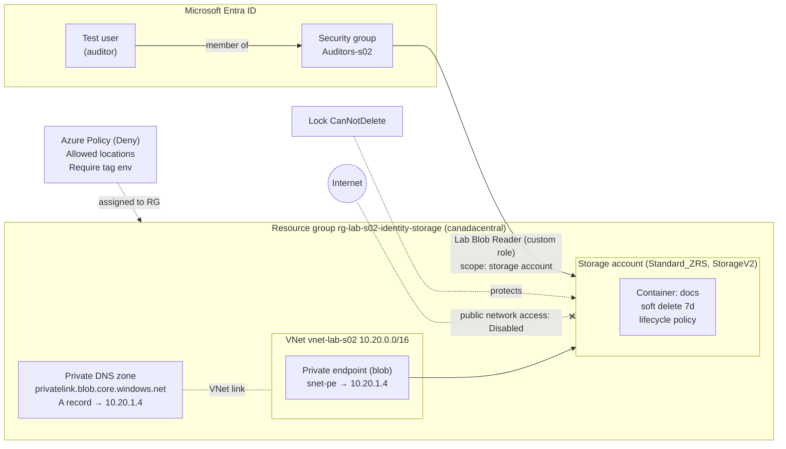
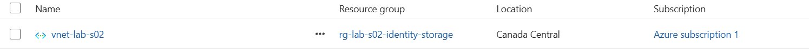
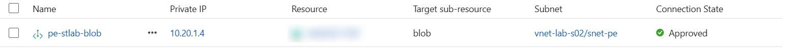
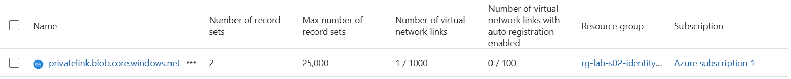

# S02 – Identity, Governance & Storage (Azure CLI)

Hands-on lab from my 60-week Azure learning plan (architect, DevOps, security track).
Everything is built with **Azure CLI** from WSL (Ubuntu) and scripted in [`deploy.sh`](./deploy.sh).

> No real environment values are committed: IDs, account names and UPNs live in a local `vars.sh` (git-ignored).
> Copy [`vars.example.sh`](./vars.example.sh) to `vars.sh` and fill in your own values.

---

## Scenario

A company stores audit reports in Azure. Requirements:

| # | Requirement | How it is met |
|---|---|---|
| 1 | An **auditors team** can **read** the reports | Entra ID security group + custom RBAC role, scoped to the storage account |
| 2 | Auditors **cannot modify** anything or **retrieve the access keys** | Role has `blobs/read` only, no write, no `listKeys/action` |
| 3 | Access is **named and traceable** | Microsoft Entra ID auth (`--auth-mode login`), no shared keys |
| 4 | Data survives **a datacenter outage** | `Standard_ZRS` (3 copies across availability zones) |
| 5 | Accidental **deletes or overwrites** can be undone | Blob + container soft delete (7 days) |
| 6 | Reports are kept **7 years**, at the lowest reasonable cost | Lifecycle management policy |
| 7 | An external auditor can get **temporary, read-only** access to one file | User delegation SAS |
| 8 | Data is reachable **from the private network only** | Private endpoint + Private DNS zone, public network access disabled |
| 9 | Resources stay **in Canada** and are **tagged** by environment | Azure Policy (built-in definitions, `Deny` effect) assigned to the resource group |
| 10 | The storage account cannot be **deleted by mistake**, even by an Owner | `CanNotDelete` resource lock |

---

## Architecture



---

## Components and design decisions

### 1. Custom RBAC role – `Lab Blob Reader (s02)`
Defined in [`custom-role.template.json`](./custom-role.template.json) (`$SCOPE` is substituted with `envsubst` at deploy time).

| Field | Content | Why |
|---|---|---|
| `Actions` | `storageAccounts/read`, `containers/read`, `resourceGroups/read` | See the account and containers (control plane) |
| `DataActions` | `containers/blobs/read` | Read report content (data plane) |
| Not included | `listKeys/action`, any `write`/`delete` | No key-based bypass, no modification |
| `AssignableScopes` | The lab resource group | Cannot be assigned elsewhere |

**Built-in alternative:** `Reader` + `Storage Blob Data Reader` on the storage account. In production I would prefer built-in roles (less maintenance); the custom role here is for learning the role definition structure.

### 2. Role assignment – group, not user; storage account, not resource group
- Assigned to the **security group**: onboarding/offboarding an auditor = group membership change, **zero** role assignment changes.
- Scoped to the **storage account**: a future storage account added to the resource group would *not* inherit auditor access (least privilege includes *future* resources).

### 3. Storage account
- `Standard_ZRS`, `StorageV2`, Hot default tier, `--min-tls-version TLS1_2`, `--allow-blob-public-access false`.
- Container `docs` created with `az storage container-rm create` (**control plane**), because as Owner I had no data-plane role: the same container via `az storage container create --auth-mode login` would return 403. *The endpoint you go through decides which permission is checked.*

### 4. Soft delete
Blob and container soft delete, 7 days. Protects against deletes **and overwrites**, but **not** against deleting the storage account itself (that is what a resource lock is for).

### 5. Lifecycle management – [`lifecycle-policy.json`](./lifecycle-policy.json)

| Days since last modification | Action |
|---|---|
| 30 | Move to Cool |
| 90 | Move to Cold |
| 2557 (≈ 7 years, rounded up for leap years) | Delete |

- **Last modified** (not last access): reports are immutable once signed, so the schedule stays predictable; a read must not postpone legal deletion.
- **Trade-off:** the Archive tier is **not supported on ZRS** accounts. Options were Cold on ZRS (chosen for the lab), a second GRS account for archiving (production design), or downgrading redundancy. Minimum durations (Cool 30 d, Cold 90 d) are respected at every step.

### 6. User delegation SAS
- Signed with an Entra ID–derived **user delegation key**, not the account key (`--auth-mode login --as-user`); max validity 7 days; `skoid`/`sktid` fields tie it to its creator.
- Effective permissions = **intersection** of the SAS permissions and the creator's own data actions.
- Requires `generateUserDelegationKey/action` (included in the built-in Storage Blob Data roles, **not** in my custom role).

### 7. Private endpoint + Private DNS
- Private endpoint (`group-id blob`) in `snet-pe`, private IP `10.20.1.4`.
- Private DNS zone `privatelink.blob.core.windows.net`, **VNet link** (auto-registration off), **DNS zone group** to create/maintain the A record automatically.
- Public network access **disabled last** – creating a private endpoint does not close the public endpoint by itself.
- Hybrid note: on-premises clients also need a **conditional forwarder** (to an Azure DNS Private Resolver inbound endpoint), otherwise their DNS returns the public IP even over VPN.

**VNet** (`10.20.0.0/16`, subnet `snet-pe` `10.20.1.0/24`):



**Private endpoint** – private IP `10.20.1.4`, target sub-resource `blob`, connection approved (storage account name redacted):



**Private DNS zone** – 2 record sets (SOA + the A record created by the DNS zone group), 1 VNet link, auto-registration off:



### 8. Azure Policy – built-in definitions only
Two built-in policy definitions, assigned at the **resource group** scope, effect `Deny`:

| Policy definition | Parameter | Effect |
|---|---|---|
| Allowed locations | `canadacentral`, `canadaeast` | Deny |
| Require a tag on resources | `tagName = env` | Deny |

- **Why built-in:** they already cover the need; a custom definition would only add maintenance. Custom definitions come later (Policy-as-Code, week 56).
- **Assigned last:** `Deny` is evaluated on **create and update** requests only. Resources created before the assignment are reported as **non-compliant**, never deleted or modified. In return, any later *update* of an untagged resource is denied until it gets the tag.
- **Global resources:** the Private DNS zone has location `global`; the built-in *Allowed locations* definition excludes `global`, so it is not blocked.
- **Scope of the tag policy:** *Require a tag on resources* does not apply to resource groups (a separate built-in exists for that).
- **Policy vs RBAC:** RBAC answers *who* can act; Policy answers *what* a resource may look like, **whoever** creates it (an Owner is denied too).
- **Next step (not done here):** `Modify` effect with a managed identity + remediation task to add the missing tag automatically (planned in weeks 27/56).

### 9. Resource lock – `lock-stlab-nodelete`
- `CanNotDelete` on the storage account: read and modify still work, **delete** fails with `ScopeLocked`, even for an Owner.
- Complements soft delete: soft delete protects **blobs and containers**, the lock protects **the account itself**.
- A lock is inherited by child scopes and **blocks the deletion of the resource group** too, so it must be removed first at cleanup.
- Removing a lock requires `Microsoft.Authorization/locks/delete` (Owner or User Access Administrator): it is a speed bump against mistakes, not a security boundary against an admin.
- **Why not `ReadOnly`:** it would also block POST operations such as `listKeys` and some data-plane management calls, which breaks legitimate tools.

---

## Tests and results

| Test | Identity / method | Expected | Result |
|---|---|---|---|
| Upload as Owner, no data role | `--auth-mode login` | 403 | ✅ 403 (Owner has no DataActions) |
| Upload after `Storage Blob Data Contributor` | `--auth-mode login` | Success | ✅ |
| Auditor downloads report | Test user via group | Success | ✅ |
| Auditor uploads a file | Test user via group | 403 | ✅ AuthorizationPermissionMismatch |
| Auditor lists access keys | Test user via group | Denied | ✅ AuthorizationFailed on `listKeys/action` |
| Soft delete: delete, list `--include d`, undelete | Data plane | Restored | ✅ |
| Read with user delegation SAS (`sp=r`) | No identity, `curl` | 200 | ✅ |
| Write with the same SAS | No identity, `curl -X PUT` | 403 | ✅ AuthorizationPermissionMismatch |
| Tampered SAS | `curl` | 403 | ✅ AuthenticationFailed |
| DNS before private endpoint | `nslookup` | Public IPs, no `privatelink` | ✅ |
| DNS after private endpoint (from Internet) | `nslookup` | `privatelink` CNAME added, still public IP | ✅ |
| Anonymous request after public access disabled | `curl` | 403 before blob existence check (would be 404 otherwise) | ✅ 403 |
| My own identity after public access disabled | `--auth-mode login` | Blocked by network rules | ✅ |
| Control plane after public access disabled | `az storage account show` | Works | ✅ |
| Create an NSG in `eastus` (with tag) | Policy *Allowed locations* | Denied | ✅ `RequestDisallowedByPolicy` |
| Create an NSG in `canadacentral` without `env` tag | Policy *Require a tag* | Denied | ✅ `RequestDisallowedByPolicy` |
| Create an NSG in `eastus` without tag | Both policies | Denied, **both** assignments listed | ✅ 2 assignments cited in the error |
| Delete the storage account | Owner, lock in place | Denied | ✅ `ScopeLocked` |
| Update tags on the storage account | Owner, lock in place | Success | ✅ (`CanNotDelete` allows modifications) |

---

## Lessons learned

- **Authentication vs authorization:** `AuthenticationFailed` (who are you? invalid proof) vs `AuthorizationPermissionMismatch` / `AuthorizationFailed` (you are known but not allowed).
- **Policy reports all violations at once:** one request breaking two assignments lists both, which saves trial-and-error.
- **Governance layers are independent:** RBAC (who), Policy (what), lock (can it be deleted), soft delete (can the data come back). Each one covers a gap the others leave.
- **Network layer before identity layer:** with public access disabled, a valid SAS is never even evaluated from the Internet.
- **`NotActions` is not a deny:** RBAC is additive; another role can grant the excluded action back.
- **Always read what was actually saved:** the portal-created lifecycle rule initially had `delete` and `tierToCold` swapped (delete after 90 days instead of 7 years). Caught by reading the JSON, fixed in Azure and in Git.
- **Variable interpolation:** bash expands `$VAR` on the command line and in unquoted heredocs, never inside a file read by another program (`@file.json`). Hence the template + `envsubst`.
- **WSL + Windows Azure CLI:** the Windows `az` binary returned CRLF line endings that corrupted variables; fixed by installing the native Linux CLI (`which az` → `/usr/bin/az`). `cat -A` is the go-to tool to spot invisible characters.

---

## How to run

```bash
cp vars.example.sh vars.sh   # fill in your values
source vars.sh
./deploy.sh                  # intended for a subscription without the lab resources
```

`deploy.sh` uses `set -euo pipefail`. User delegation SAS generation is documented as a commented example (a SAS is a secret and is never stored).

## Cleanup

Order matters: the lock blocks the resource group deletion.

```bash
az lock delete --name lock-stlab-nodelete --resource-group "$RG" \
  --resource "$SA" --resource-type Microsoft.Storage/storageAccounts
az group delete --name "$RG" --yes          # storage, VNet, private endpoint, DNS zone,
                                            # policy and role assignments at RG scope or below
az role definition delete --name "Lab Blob Reader (s02)"
az ad group delete --group "Auditors-s02"   # Entra ID objects are NOT in the resource group
```

Approximate cost: a few cents (the private endpoint is the only hourly-billed item; everything else is free or negligible at this scale).
