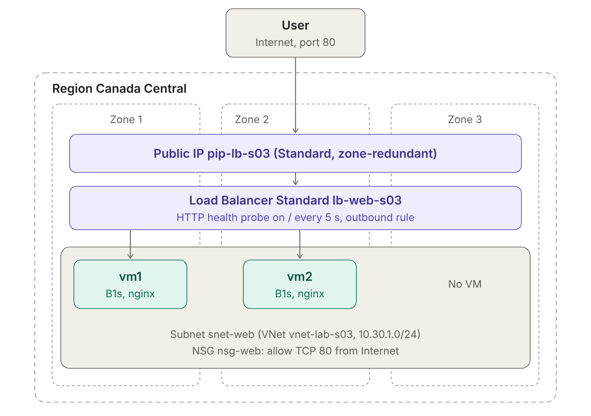
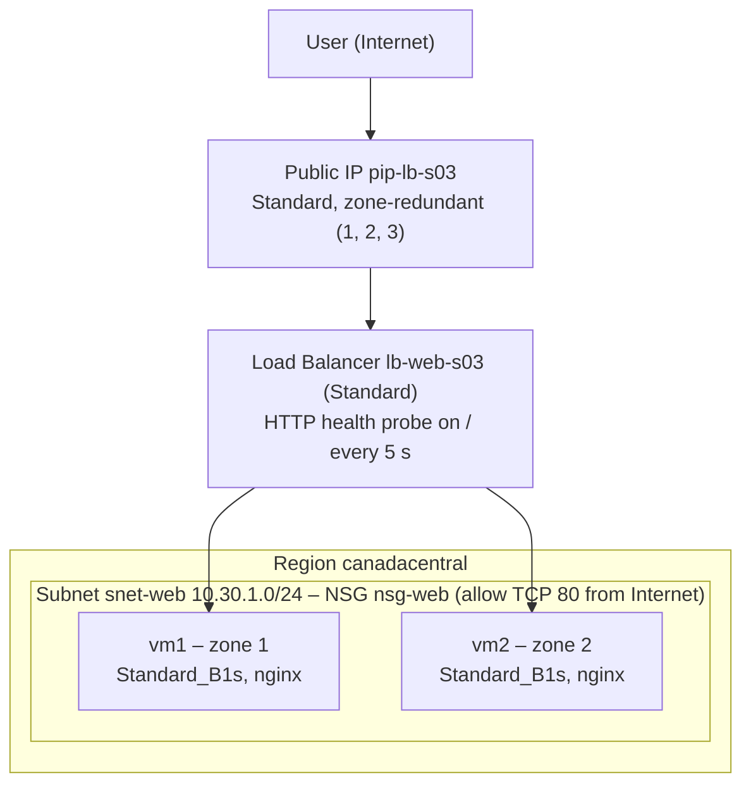
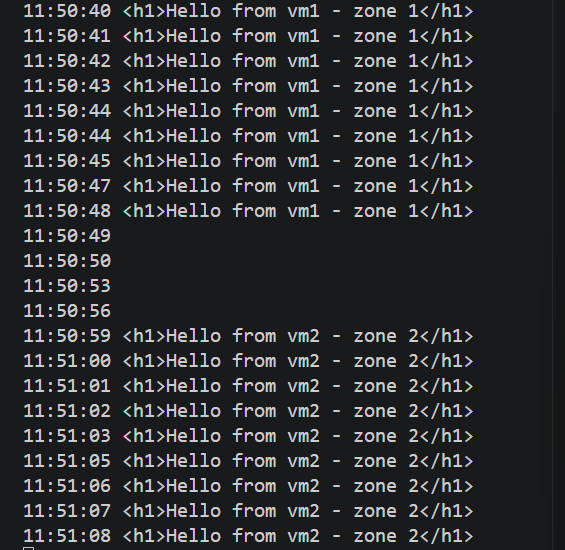
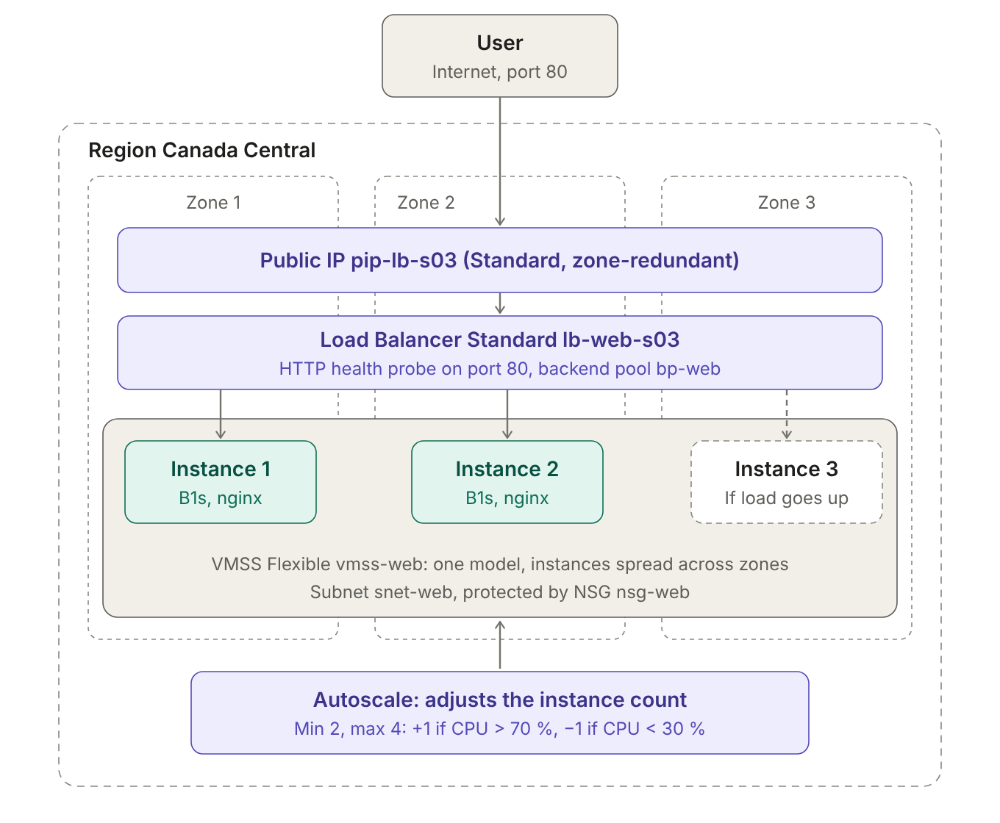
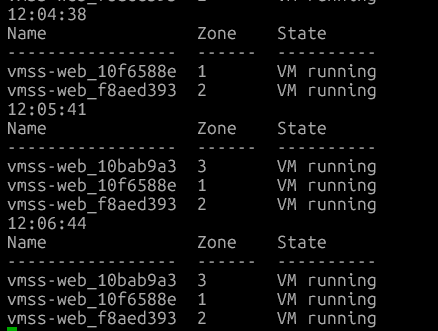
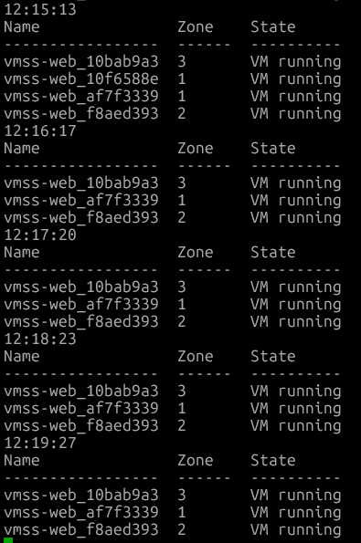

# S03 – Compute, Monitoring & Backup (Azure CLI)

Hands-on labs from my 60-week Azure learning plan (architect, DevOps, security track).
Everything is built with **Azure CLI** from WSL (Ubuntu).

> No real environment values are committed. Copy [`vars.example.sh`](./vars.example.sh) to `vars.sh` (git-ignored).

| Lab | Topic | Status |
|---|---|---|
| 1 | Zonal VMs behind a zone-redundant Load Balancer, zone failure test | ✅ Built and tested |
| 2 | VM Scale Set across 3 zones with autoscale | ✅ Built and tested |
| 3 | App Service with a staging slot | To do |
| 4 | Containers: ACR + ACI | To do |
| 5 | Monitoring: Log Analytics, KQL, alerts | To do |
| 6 | Backup and restore of a VM | To do |

---

## Lab 1 – Surviving the loss of an availability zone

### Scenario
A small web application must keep answering if one availability zone of Canada Central fails.

### Architecture



<details><summary>Same diagram as Mermaid source</summary>



</details>

Built with [`deploy.sh`](./deploy.sh). nginx is installed at first boot by [`cloud-init.yaml`](./cloud-init.yaml); each VM serves a page with its hostname and the zone it reads from the Instance Metadata Service (IMDS).

### Design decisions

**One VM per zone, not one "multi-zone" VM.** A zonal VM is pinned to its zone: if the zone fails, the VM fails with it and Azure does not move it. Redundancy comes from several VMs in different zones.

**Load Balancer + health probe.** Users only know one IP. An HTTP probe on `/` every 5 seconds takes an unhealthy VM out of rotation automatically.

**Zone-redundant frontend.** Spreading the VMs is useless if the entry point lives in a single zone: it would become a single point of failure. The public IP is created with `--zone 1 2 3`, which requires the **Standard** SKU (Basic is retired and has no zone support).

**No public IP on the VMs.** The VMs are only reachable through the Load Balancer. For outbound traffic (package installation), the load balancing rule has `--disable-outbound-snat true` and an **explicit outbound rule** lets the backend pool use the Load Balancer's public IP (SNAT). Default outbound access is being retired, so outbound connectivity is planned explicitly.

**NSG on the subnet.** One rule (priority 100) allows TCP 80 from the `Internet` service tag. Health probes are allowed by the default rule `AllowAzureLoadBalancerInBound`; everything else inbound is denied by `DenyAllInBound`.

**Disks.** OS disks are `StandardSSD_LRS`: LRS keeps 3 copies in the **same zone** as the VM, so a zone failure makes the disk unavailable too. This is acceptable here because the web servers are **stateless**; important data would live in a zone-redundant service, with backups.

### Tests and results

| Test | Method | Expected | Result |
|---|---|---|---|
| Size available in zones | `az vm list-skus --zone` | Zones 1, 2, 3, no restriction | ✅ |
| End-to-end through the LB (vm1 only) | `curl` | `Hello from vm1 - zone 1` | ✅ |
| vm2 not yet receiving traffic | Run Command + `DipAvailability` metric | Probe at 0 while cloud-init installs nginx | ✅ 0 then 100 one minute later |
| Distribution across both VMs | 30 × `curl` \| `sort \| uniq -c` | Both VMs answer | ✅ 24 vm1 / 6 vm2 (hash-based, not round-robin) |
| **Zone 1 failure** (vm1 stopped) | `curl` every second during `az vm stop` | Short gap, then vm2 only | ✅ ~10 s without answer, then vm2 only |
| vm1 restarted | Same loop during `az vm start` | Back in rotation only once the probe succeeds | ✅ No failed request on the way back |
| OS disk location | `az disk list` | Same zone as the VM, `StandardSSD_LRS` | ✅ vm1 disk in zone 1, vm2 disk in zone 2 |
| Temporary disk on `Standard_B1s` | Run Command: `lsblk`, `df -h /mnt` | Checked, not assumed | ✅ 4 GB `sdb1` mounted on `/mnt` (OS disk `sda` 30 GB) |

**Failover test** – left: requests every second; vm1 is stopped at 11:50:48, the probe marks it unhealthy and traffic moves to vm2:



```text
11:50:48 <h1>Hello from vm1 - zone 1</h1>
11:50:49                                   <- vm1 is going down, requests time out (curl -m 2)
11:50:56
11:50:59 <h1>Hello from vm2 - zone 2</h1>  <- probe marked vm1 down, all traffic to vm2
```

### Lessons learned
- **Failover is not instantaneous.** The gap (~10 s here) comes from the probe interval and the number of failed probes before a VM is removed. A shorter interval reduces it, at the cost of more probe traffic.
- **A running VM is not a healthy backend.** `VM running` only means the OS is up; the Load Balancer trusts the **health probe**. During cloud-init, vm2 was running but correctly received no traffic.
- **Troubleshooting a VM without public IP:** `az vm run-command invoke` runs a script through the VM agent (no SSH, no network path needed).
- **Troubleshooting from the Load Balancer side:** the `DipAvailability` metric (*Health Probe Status*) per backend IP shows exactly when each VM was considered healthy.
- **Failover is asymmetric.** Going down, the Load Balancer learns about the failure *after* it happened (lost requests). Coming back, it adds the VM only *after* the probe succeeds (no loss). In production, the probe should hit a dedicated `/health` endpoint that checks the application's real readiness.
- **Load distribution is hash-based** (source IP/port, destination, protocol), so short tests from one client are never perfectly balanced.
- **Heredoc quoting:** `<<'EOF'` keeps `$(hostname)` and `$ZONE` literal in `cloud-init.yaml`, so they are evaluated on the VM, not on my workstation.

### What restarts a VM (and loses the temporary disk)
The key question is: **does the VM have to move to another host?**
- No (e.g. resize to a size available on the same cluster): reboot in place, temporary disk kept.
- Yes (deallocate/start, redeploy, resize to a size not available on the cluster, host failure): reboot **and** temporary disk content lost.
- Attaching a data disk does not restart the VM (managed disks live in Azure Storage, not on the host).
- From the v4 generations on, a size only has a temporary disk if its name contains `d` (e.g. `D4ds_v5`, not `D4s_v5`). Older sizes without that rule may still have one: `Standard_B1s` has a 4 GB temporary disk on `/mnt`, despite having no `d`. **Check, don't assume.**

### Cleanup

```bash
az group delete --name "$RG" --yes
az group exists --name "$RG"   # expected: false
```

---

## Lab 2 – VM Scale Set (Flexible) across 3 zones with autoscale

### Scenario
Same web application, but instances are no longer created one by one: a scale set creates them from one model, spreads them across zones and adjusts their number to the load.

### Architecture



### Design decisions
- **Flexible orchestration:** instances are standard Azure VMs (manageable individually), recommended by Microsoft for new deployments.
- **One model, one count:** size, image, cloud-init, subnet and backend pool are defined once; the scale set creates NICs, disks and VMs and registers them in the pool.
- **Minimum 2 instances:** with 1 instance in a single zone, a zone failure means a full outage until a new instance is provisioned (minutes). Two instances in different zones keep the ~10 s failover seen in lab 1.
- **Scale-out +1 if CPU > 70 % for 5 min, scale-in −1 if CPU < 30 %:** the gap between thresholds prevents **flapping** (removing an instance raises the CPU of the remaining ones; with 69 %/70 %, 3 × 60 % would become 2 × 90 % and trigger a scale-out again).
- **Cooldown:** after each action, autoscale waits before evaluating again, because a new instance only takes traffic once provisioning, cloud-init and the health probe have succeeded.

### Build
Same base as lab 1 (VNet, NSG, zone-redundant public IP, Load Balancer with probe, rule and outbound rule), then:

```bash
az vmss create --name vmss-web --resource-group "$RG" --location "$LOC" \
  --orchestration-mode Flexible --zones 1 2 3 --platform-fault-domain-count 1 \
  --vm-sku Standard_B1s --image Ubuntu2404 --instance-count 2 \
  --vnet-name vnet-lab-s03 --subnet snet-web \
  --lb lb-web-s03 --backend-pool-name bp-web \
  --storage-sku StandardSSD_LRS --admin-username azureuser --generate-ssh-keys \
  --custom-data cloud-init.yaml --tags env=lab week=s03 -o none

az monitor autoscale create --name autoscale-web --resource-group "$RG" \
  --resource vmss-web --resource-type Microsoft.Compute/virtualMachineScaleSets \
  --min-count 2 --max-count 4 --count 2 -o none
az monitor autoscale rule create --autoscale-name autoscale-web --resource-group "$RG" \
  --condition "Percentage CPU > 70 avg 5m" --scale out 1 --cooldown 5 -o none
az monitor autoscale rule create --autoscale-name autoscale-web --resource-group "$RG" \
  --condition "Percentage CPU < 30 avg 5m" --scale in 1 --cooldown 5 -o none
```

CPU load was generated with Run Command on each instance: `nohup timeout 900 yes > /dev/null 2>&1 &` (stopped early with `pkill yes`).

### Tests and results

| Time (local) | Event | Observation |
|---|---|---|
| 11:41 | VMSS created, 2 instances | Zone balancing placed them in zones 1 and 2 automatically, both registered in the backend pool |
| 11:44 | Traffic test | Both instances answer (hash-based, uneven on a small sample) |
| 11:58 | CPU load started on both instances | `Percentage CPU` (VMSS average): 0.4 % → 94 % within 2 minutes |
| 12:05 | **Scale-out 2 → 3** | New instance in **zone 3**, serving traffic ~2 minutes later (cloud-init + probe), no manual step |
| 12:10 | **Unexpected scale-out 3 → 4** | Fourth instance in zone 1 (max reached) – see lessons learned |
| 12:11 | Load stopped (`pkill yes`) | |
| 12:16 | **Scale-in 4 → 3** | The removed instance came from zone 1 (the only zone with 2), restoring 1 instance per zone |
| next | Scale-in 3 → 2 expected after the 5-minute cooldown, then stop at the minimum | |

**Scale-out** – a third instance appears in zone 3, then a fourth in zone 1:



**Scale-in** – one instance of zone 1 is removed, one instance per zone remains:



### Lessons learned
- **The prediction "3 instances → average 67 %, no fourth instance" was right on paper and wrong in practice.** A new instance only reports CPU metrics after it has booted. During its first minutes, the VMSS average was computed on the 2 loaded instances only (≈ 100 %), so when the cooldown ended at 12:10 the scale-out rule fired again. Mitigations: a longer cooldown than the instance warm-up time, or a predictive/scheduled profile for known peaks.
- **The latest metric minute is incomplete** (15:59 read 0.35 %, then 32 % a minute later). Autoscale and humans should not react to the last data point.
- **Minimum and maximum always win over rules:** CPU at 0.4 % before the test did not scale in below 2; at 4 instances, no further scale-out was possible.
- **Zone balancing works both ways:** new instances go to the emptiest zone, removed instances come from the fullest zone.
- **Two different names per instance:** the Azure resource name (`vmss-web_<id>`, used by CLI/portal) and the Linux computer name (`vmss-web<random>`, returned by `hostname`).
- **Burstable sizes and sustained load:** a B1s runs on CPU credits; a constant load beyond the credits would be throttled to its baseline. Fine for this test, wrong for a production workload with steady CPU.
- **Before trusting a hypothesis, measure it:** an uneven distribution looked like an nginx failure; the `DipAvailability` metric showed both instances healthy (it was the hash).
