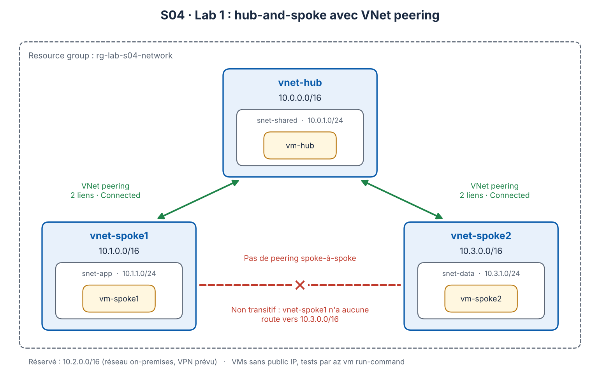
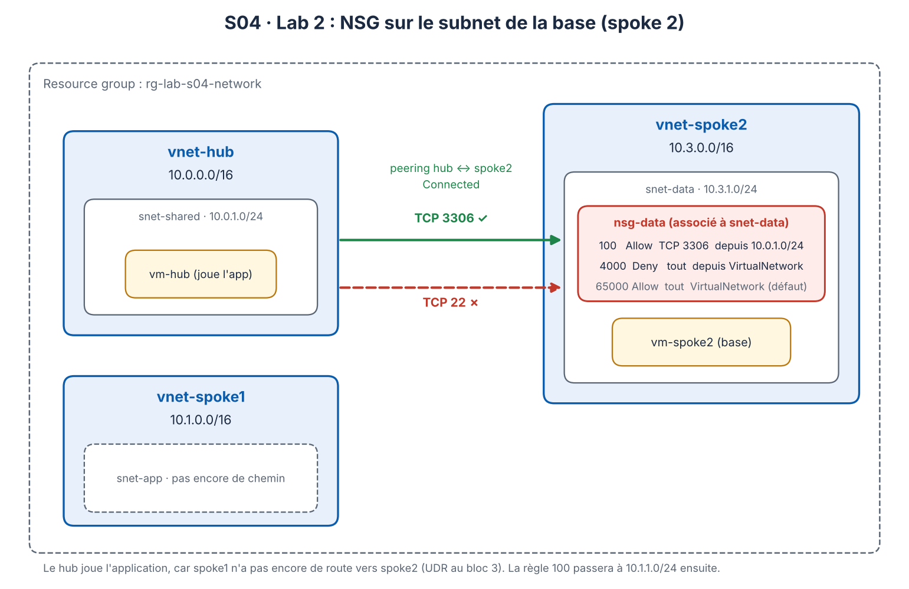

# S04 – Networking & Review (Azure CLI)

Hands-on labs from my 60-week Azure learning plan (architect, DevOps, security track).
Everything is built with **Azure CLI** from WSL (Ubuntu).

> No real environment values are committed. Copy [`vars.example.sh`](./vars.example.sh) to `vars.sh` (git-ignored).

| Lab | Topic | Status |
|---|---|---|
| 1 | Hub-and-spoke with VNet peering, non-transitivity | ✅ Built and tested |
| 2 | NSG on the database subnet: rules, priorities, service tags | ✅ Built and tested |
| 3 | UDR through a firewall (NVA) | ⏳ To do |
| 4 | Azure Bastion | ⏳ To do |
| 5 | Internal Load Balancer with health probe | ⏳ To do |

---

## Lab 1 – Hub-and-spoke with VNet peering

### Scenario
An application in spoke 1 and a database in spoke 2 live in separate, isolated VNets. Shared services will sit in a hub. Before adding any filtering, I wanted to prove who can talk to whom.

### Architecture



Built with [`deploy.sh`](./deploy.sh).

### Design decisions

**Address spaces that hold over time.** Hub `10.0.0.0/16`, spoke 1 `10.1.0.0/16`, spoke 2 `10.3.0.0/16`. `10.2.0.0/16` is deliberately left unused because it belongs to the on-premises network that a VPN will connect to the hub later. Two spokes with the same range would already be rejected at peering time (address space overlap), because the hub could not tell where to send a packet. Renumbering a subnet that hosts resources later means moving VMs and rewriting NSG, route and DNS references, while picking the range now costs nothing.

**One peering link per direction.** A single link stays `Initiated`. As soon as the second link exists, both become `Connected`. In CLI, forgetting the second command is the classic mistake.

**No spoke-to-spoke peering.** The hub is the single crossing point, so that a firewall can filter and log traffic later. A direct peering would be simpler and faster, but it bypasses filtering and logging, and it does not scale (10 spokes talking to each other would need 45 peerings, each created in both directions).

**No public IP, no NSG on the VMs.** Tests run through `az vm run-command`, which uses the Azure agent and needs no network path to the VM. NSGs are added on purpose in lab 2.

### Results

| Test | Result |
|---|---|
| `vm-hub` → `vm-spoke1` | 0 % packet loss |
| `vm-hub` → `vm-spoke2` | 0 % packet loss |
| `vm-spoke1` → `vm-spoke2` | 100 % packet loss |

### Why spoke 1 cannot reach spoke 2: the routes

Effective routes of `vm-spoke1` (Azure reserved ranges omitted):

```text
Source    State    Address Prefix     Next Hop Type
Default   Active   10.1.0.0/16        VnetLocal
Default   Active   10.0.0.0/16        VNetPeering
Default   Active   0.0.0.0/0          Internet
Default   Active   10.0.0.0/8         None
```

Peering is **not transitive** because a peering only adds a route to the VNet on the other side: spoke 1 learns `10.0.0.0/16` (the hub) and nothing else. There is no `10.3.0.0/16` line. For a packet to `10.3.1.4`, the only matching route is the system route `10.0.0.0/8` with next hop `None`, so Azure silently drops it. When several routes match, the most specific prefix wins: for `10.0.1.4`, `/16` beats `/8`, which is why the hub answers.

The missing line is exactly what a user-defined route (UDR) pointing at the hub will add in lab 3.

### Clean-up
Resources are kept (VMs deallocated) until the end of S04, then removed with `az group delete -n "$RG" --yes --no-wait`.

---

## Lab 2 – Restricting access to the database subnet with an NSG

### Scenario
Only the application may reach the database port. By default, everything in a VNet, including peered VNets, can reach everything else, so the hub could open an SSH session on the database VM.

### Architecture



Built with the lab 2 section of [`deploy.sh`](./deploy.sh). Spoke 1 has no route to spoke 2 yet (UDR in lab 3), so `vm-hub` plays the application: rule 100 uses the hub subnet `10.0.1.0/24` and will point to the real application subnet `10.1.1.0/24` once lab 3 is done.

### Design decisions

**Rules, in order.** Priority 100 allows TCP 3306 from the application subnet. Priority 4000 denies all traffic from the `VirtualNetwork` service tag. The `Allow` has the smaller number, so it is read first; a `Deny` with a smaller number would hide it.

**Why the explicit Deny is needed.** The default rule `AllowVNetInBound` (65000) allows the `VirtualNetwork` tag, which includes the VNet itself, **peered VNets** and on-premises networks connected through a gateway. Without rule 4000, everything in the hub, and later on-premises, would reach the database.

**Associated with the subnet, not the NIC.** For inbound traffic Azure reads the subnet NSG first, then the NIC NSG, and both must allow. Microsoft recommends one level only, to avoid conflicting rules that are hard to troubleshoot. An NSG that is not associated filters nothing.

**Source by address range, not by ASG.** An application security group can only contain NICs from one VNet, and a rule with an ASG as source and another as destination requires both in the same VNet. The application (spoke 1) and the database (spoke 2) are in different VNets, so the source is a CIDR range.

### Results (from `vm-hub` to `vm-spoke2`)

| State | TCP 22 | TCP 3306 |
|---|---|---|
| No NSG | succeeded | succeeded |
| `nsg-data` created, not associated | succeeded | succeeded |
| `nsg-data` associated with `snet-data` | timed out | succeeded |

A timeout means the packet was dropped on the way (NSG or missing route). `Connection refused` would mean it reached the VM and nothing listens on that port.

Effective rules of the database NIC, in reading order:

```text
Prio    Name                          Access   Src
100     allow-3306-from-hub           Allow    10.0.1.0/24
4000    deny-vnet-inbound             Deny     VirtualNetwork
65000   AllowVnetInBound              Allow    VirtualNetwork
65001   AllowAzureLoadBalancerInBound Allow    AzureLoadBalancer
65500   DenyAllInBound                Deny     0.0.0.0/0
```

Traffic from the hub on port 22 stops at rule 4000; rule 65000 is never read for it.
